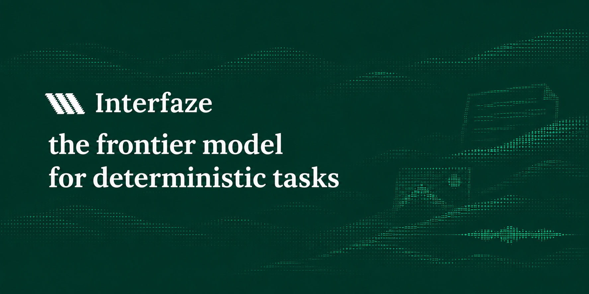

# Interfaze plugin for AI agents

**Accurate, verifiable output in one call.** [Interfaze](https://interfaze.ai) is a model built for deterministic tasks such as OCR, audio understanding and structured data extraction. It gives one model you can trust instead of a pipeline of OCR tools, speech APIs, classifiers and glue code.

This plugin connects an AI agent to the hosted Interfaze MCP server and adds skills that tell the agent which tool to use. It is an [Agent Plugins](https://agent-plugins.org) 1.0.0 package with no local code. It works with [Hermes Agent](https://hermes-agent.nousresearch.com), [OpenClaw](https://openclaw.ai) and [Claude Code](https://code.claude.com).

Interfaze is free to try without a key. For more calls, get a free API key from the dashboard at [interfaze.ai](https://interfaze.ai).

If you encounter an issue, please contact support at [support@interfaze.ai](mailto:support@interfaze.ai).

## Tools

| Tool | Description |
|---|---|
| `ask_interfaze` | Handles tasks with several steps, and calls the other tools when it needs them. |
| `web_search` | Searches the web for current information. |
| `scraper` | Gets structured data from a web page. |
| `ocr` | Reads text from images, PDFs and Word documents. |
| `speech_to_text` | Transcribes audio and video. |
| `object_detection` | Finds objects in an image or PDF, with bounding boxes. |
| `gui_detection` | Finds buttons, inputs and links in a screenshot. |
| `translate` | Translates text. |
| `classification` | Sorts text or images into labels that you give. |
| `forecast` | Predicts future values from a dated series. |
| `get_upload_url` | Gives a URL to upload a local file to. |

## Hermes Agent

Requires Hermes Agent 0.22.6 or later.

1. Install the plugin from the Hermes plugin catalog:

   ```bash
   hermes plugins install interfaze
   ```

2. Hermes installs portable packages disabled, so enable the plugin in the profile that you chat from:

   ```bash
   hermes plugins enable interfaze
   ```

3. Set up a key or keyless access in the same profile.

   With a key:

   ```bash
   hermes config set INTERFAZE_API_KEY <your-key>
   ```

   Keyless:

   ```bash
   hermes config set mcp_servers.interfaze.url https://api.interfaze.ai/mcp
   hermes config set mcp_servers.interfaze.trust untrusted
   ```

   If `INTERFAZE_API_KEY` is not set, Hermes does not connect the plugin's server. This server entry has the same name and no key, so Hermes uses it instead. To move to a key later, run `hermes mcp remove interfaze`, set the key, and do step 4 again.

4. Restart the gateway, then start a new session:

   ```bash
   hermes gateway restart
   ```

   The gateway keeps the server connection open, so a change to the key or the server entry applies only after a restart.

Hermes names the tools `mcp__interfaze__<tool>`, for example `mcp__interfaze__ocr`. The skills load as `interfaze:<skill>`.

The plugin and the keyless entry mark the server `trust: untrusted`, so Hermes runs the read-only tools without a prompt and asks for approval before each `get_upload_url` call. You can approve it once, for the session, or always.

## OpenClaw

1. Install the plugin from ClawHub:

   ```bash
   openclaw plugins install clawhub:@interfaze/interfaze
   ```

   OpenClaw shows the ClawHub security audit, then asks you to approve the install and accept the plugin's capabilities. In a script or without a terminal, add `--accept-capabilities`.

2. If you use a key, add it to `~/.openclaw/.env`. A Gateway that runs as a service does not see a variable that you set only in your shell.

   ```bash
   INTERFAZE_API_KEY=<your-key>
   ```

3. Add the server to the OpenClaw configuration.

   With a key:

   ```bash
   openclaw mcp set interfaze '{"url":"https://api.interfaze.ai/mcp","transport":"streamable-http","headers":{"Authorization":"Bearer ${INTERFAZE_API_KEY}"}}'
   ```

   Keyless:

   ```bash
   openclaw mcp set interfaze '{"url":"https://api.interfaze.ai/mcp","transport":"streamable-http"}'
   ```

   OpenClaw sends the header of the plugin's own server entry with a literal `${INTERFAZE_API_KEY}`, so the server rejects it. This entry replaces it. OpenClaw reads the key from the environment and does not write it to the configuration file.

4. Stop the Gateway, then check the connection. The output shows `interfaze: 11 tools`.

   ```bash
   openclaw mcp probe interfaze
   ```

5. Start the Gateway and start a new session.

OpenClaw names the tools `interfaze__<tool>`, for example `interfaze__ocr`.

## Claude Code

1. Add this repository as a plugin marketplace, then install the plugin:

   ```text
   /plugin marketplace add InterfazeAI/interfaze-agent-plugin
   /plugin install interfaze@interfaze
   ```

2. For a key, set `INTERFAZE_API_KEY` in the environment that starts Claude Code. Without it, the plugin connects keyless.
3. Start a new session.

## Local files

The tools take files as `https` URLs. For a local file, the agent calls `get_upload_url`, uploads the file with an HTTP PUT (for example `curl -T ./receipt.jpg '<upload_url>'`), and passes the returned `file_url` in `files`. The upload needs a shell tool. Without one, give the agent a public URL of the file.
